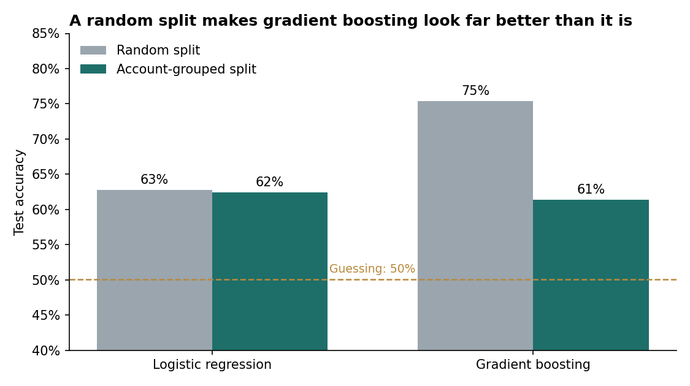
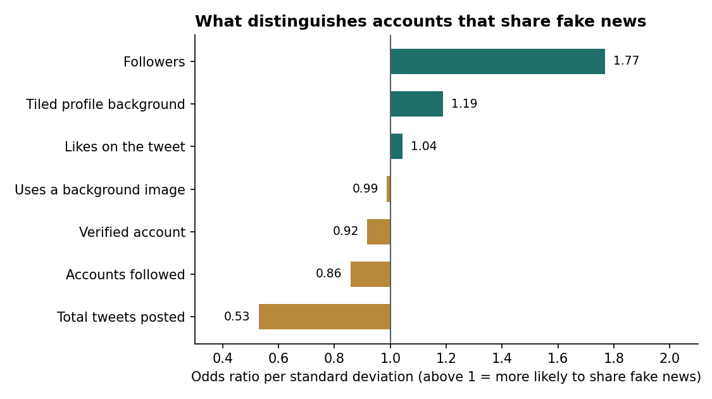

# Can Account Behavior Identify Fake News Sharers? (Python)

Can you tell who's sharing fake news just from their Twitter account, without reading what they post? This project tests that on **1.3 million tweets** from the FakeNewsNet dataset, using account traits such as followers, activity, verification, and profile settings.

It's an updated analysis of an earlier team project. The main change is **how the models are tested**: a naive train/test split turned out to overstate one model's accuracy by 14 points.

**Tools:** Python · pandas · scikit-learn · logistic regression · gradient boosting · matplotlib

---

## Key findings

**1. A random split made the stronger model look far better than it is.**
The same accounts tweet many times. With a random split, about 49,000 accounts appear in both the training and test data, so a flexible model can score well just by *recognizing accounts it has already seen*. Gradient boosting scores **75%** that way, and drops to **61%** once each account is kept entirely on one side of the split. Logistic regression barely moves (63% → 62%), because it learns general patterns rather than individual accounts.



**2. Account traits carry a real but modest signal.**
Tested on accounts the model has never seen, the best result is **62% accuracy (AUC 0.67)** against a 50% baseline. Account behavior helps, but it can't reliably identify fake news on its own. Any real system would also need the content of the tweets.

| Model | Split | Accuracy | AUC | Recall (fake) | Precision (fake) |
|---|---|---|---|---|---|
| Logistic regression | Random | 0.628 | 0.668 | 0.601 | 0.630 |
| Gradient boosting | Random | 0.754 | 0.804 | 0.935 | 0.684 |
| **Logistic regression** | **Account-grouped** | **0.624** | **0.669** | **0.574** | **0.637** |
| Gradient boosting | Account-grouped | 0.614 | 0.654 | 0.933 | 0.570 |

*Baseline (always guess the larger class): 50.1%. Test set: about 370,000 tweets.*

**3. Accounts sharing fake news post less but have larger audiences for their activity level.**
Holding the other traits constant, each standard deviation more **total tweets** cuts the odds of sharing fake news by about half (odds ratio 0.53). Each standard deviation more **followers** raises them by 77% (odds ratio 1.77). This combination is consistent with newer or amplification-style accounts that have built an audience without much organic posting. It describes an association, not proof of intent.



---

## Method notes

- **Account-grouped split.** `GroupShuffleSplit` keeps every tweet from an account in either the training set or the test set, never both. This is the fair test for a model meant to judge *new* accounts.
- **Log-transformed counts.** Followers, following, and tweet counts are extremely skewed, with a few accounts in the millions, so they're log-transformed before modelling.
- **No tweet text.** The question is whether account behavior alone carries a signal, so tweet text and location are left out on purpose.
- **Account IDs.** In the source CSVs, user IDs are stored in rounded scientific notation, so a few distinct accounts can share an ID. Grouping on the rounded ID merges those accounts, which makes the split slightly *stricter*, not looser.

---

## Repository structure

```
analysis.py     Loads the data, trains both models under both splits, saves results and charts
images/         Charts and the model results table produced by analysis.py
```

## Running it

1. Get the tweet-level FakeNewsNet CSVs (`FakeNewsNet_Fake.csv` and `FakeNewsNet_Real.csv`) and place them in `data/`. The dataset originates from the [FakeNewsNet project](https://github.com/KaiDMML/FakeNewsNet) and isn't redistributed here.
2. Install the requirements and run:
   ```bash
   pip install pandas numpy scikit-learn matplotlib
   python analysis.py
   ```

The random seed is fixed, so results match those above.

---

**Rimsha Tahir** · Data Analyst · [Portfolio](https://rimshaahson.github.io/) · [LinkedIn](https://www.linkedin.com/in/rimshatahir1)
